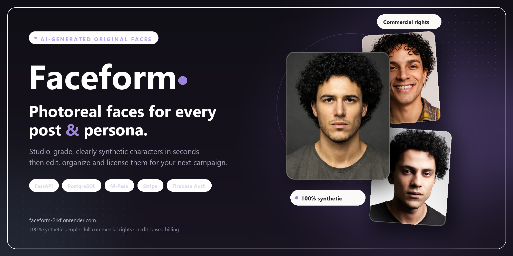

<p align="center">
  
</p>

<h1 align="center">Faceform</h1>

<p align="center">
  <strong>Photoreal faces for every post &amp; persona.</strong><br/>
  Turn a written creative brief into studio-grade, clearly synthetic portraits — then organize, iterate and license them with credit-based billing.
</p>

<p align="center">
  <a href="https://faceform-2rkf.onrender.com/">
    
  </a>
  <a href="https://github.com/lyle-mlengineer/faceform/actions/workflows/ci.yml">
    
  </a>
  
  
  
</p>

<p align="center">
  <a href="https://faceform-2rkf.onrender.com/"><strong>Open the live app</strong></a> ·
  <a href="https://faceform-2rkf.onrender.com/docs">API documentation</a> ·
  <a href="https://github.com/lyle-mlengineer/faceform/issues">Report a bug</a> ·
  <a href="https://github.com/lyle-mlengineer/faceform/issues">Request a feature</a>
</p>

> **The short version** — Describe the person you need. Faceform generates original, photorealistic faces you are free to use, then gives you a gallery, albums and pay-per-image credits. Try one as a guest; create an account to download, keep and scale.

---

## What Faceform does — and who it is for

**Faceform is an AI portrait studio for people who need faces they are allowed to use.** You write a casting brief — age range, ethnicity, features, accessories, styling — and receive a set of unique headshots in seconds. The faces are entirely synthetic: there is no model to book, no release to chase and no recognisable person to infringe.

It is built for:

| You are… | Faceform gives you… |
|---|---|
| A **social media manager** | Fresh, on-brand faces for every post and ad variation |
| A **small agency or brand team** | A reusable cast without stock-licence or model-release overhead |
| An **indie creator or founder** | Anonymous, professional presentation without a photoshoot |
| A **team in Kenya & East Africa** | Native M-Pesa billing in Kenyan shillings, with cards as a fallback |

The product is one deliberately simple loop: **brief → generate → curate → download → reuse.**

## Product tour

| Capability | What you get |
|---|---|
| **Brief-to-portrait studio** | A guided form capturing title, gender, age range, ethnicity, a detailed feature description and the number of images to generate |
| **Guest trial** | One free generation before signing up; a signed guest token carries the result into your new account |
| **Face gallery** | Every generation in one place, with actions to rename, download and delete |
| **Albums** | Group faces by campaign or persona; each album has a title and description |
| **Regenerate & refine** | Re-run a brief for new variations, or update the brief when the casting is not quite right |
| **Starter faces** | A public gallery of pre-generated examples with editable briefs that prefill the studio |
| **Credits & billing** | A credit ledger, dashboard, and packs paid by M-Pesa or card — no monthly subscription |
| **Accounts** | Email and password, plus Google sign-in through Firebase |

## How to use Faceform

**1. Open the studio.** Visit [the live product page](https://faceform-2rkf.onrender.com/product), or run it locally and go to `/product`. No account is required to start.

**2. Write the brief.** Choose the gender, age range and ethnicity, then describe the details that make the person feel real — hair, eyes, expression, glasses, earrings, lighting. Pick how many variations you want.

**3. Generate.** Faceform turns the brief into photoreal portraits. Your first guest generation is free; later generations use credits, at **6 credits per image** by default.

**4. Sign in to keep it.** Register or sign in with email or Google. The guest generation is claimed automatically, and downloads become available.

**5. Curate and reuse.** Rename images, sort them into albums, regenerate for alternatives, and download the final selects.

**6. Top up when you need more.** Credits are sold in packs — no subscription and no recurring charge.

| Pack | Credits | Price (KES) | Approx. images |
|---|---:|---:|---:|
| Starter | 60 | 500 | 10 |
| Creator | 150 | 1,000 | 25 |
| Studio | 400 | 2,500 | 66 |

*Packs and the per-image rate are configurable through `CREDIT_PACKS` and `CREDITS_PER_IMAGE`.*

### Paying for credits

- **M-Pesa STK push** — approve the prompt on your phone.
- **M-Pesa Paybill or Till** — pay manually and the receipt is confirmed by a trusted callback.
- **Daraja QR** — scan and pay.
- **Card** — Stripe Checkout as the fallback.

Payments are **idempotent**: credits are granted once, and only after the provider confirms the payment. A failed generation refunds its credits automatically.

## Architecture

**Faceform is a domain-driven monolith, on purpose.** One deployable service keeps operations simple on Render while the domain stays explicit: rich dataclass entities and domain events live in `app/domain`, while Pydantic models guard the HTTP boundary.

```text
app/
├── api.py            # HTTP routes and request/response orchestration
├── domain/           # Dataclass entities and domain events
├── services.py       # Credits, payments and workflow rules
├── providers.py      # Image provider + M-Pesa and Stripe adapters
├── models.py         # SQLAlchemy persistence models
├── schemas.py        # Pydantic request/response contracts
├── security.py       # Password hashing and JWT handling
├── templates/        # Jinja2 pages (landing, studio, gallery, billing…)
├── static/           # CSS, JavaScript and starter-face data
└── main.py           # App factory, routing and lifespan
tests/                # API and page tests
```

**Money paths are treated as first-class.** Credit debits, refunds and provider confirmations are recorded in a ledger, and M-Pesa callbacks plus Stripe webhooks are safe to retry.

## Run it locally

**Prerequisites:** Python 3.11+, PostgreSQL 14+, and an image-generation provider key for real portraits.

### 1. Clone and install

```bash
git clone https://github.com/lyle-mlengineer/faceform.git
cd faceform
python -m venv .venv
source .venv/bin/activate          # Windows: .venv\Scripts\Activate.ps1
python -m pip install -r requirements.txt
```

### 2. Create the database

```bash
createdb faceform
```

Or start PostgreSQL with Docker:

```bash
docker run --name faceform-db \
  -e POSTGRES_USER=faceform \
  -e POSTGRES_PASSWORD=faceform \
  -e POSTGRES_DB=faceform \
  -p 5432:5432 -d postgres:16
```

### 3. Configure the environment

```bash
cp .env.example .env               # Windows: Copy-Item .env.example .env
python -c "import secrets; print(secrets.token_urlsafe(48))"
```

Put the generated value in `JWT_SECRET`, then set `DATABASE_URL` and your provider credentials.

> **Image generation needs a provider.** Faceform is currently wired to **NVIDIA Flux 3** through `NVIDIA_API_KEY`. Without a configured provider, generation requests fail rather than returning a placeholder image.

### 4. Run the app

```bash
uvicorn app.main:app --reload
```

| URL | What is there |
|---|---|
| `http://127.0.0.1:8000/` | Marketing landing page |
| `/product` | Multi-step face studio |
| `/gallery`, `/inspiration` | Your faces and the starter gallery |
| `/billing`, `/dashboard` | Credits and account overview |
| `/docs` | Interactive OpenAPI documentation |
| `/api/v1` | JSON API root |

Tables are created automatically on startup. In `development`, credit checks are disabled by default so you can test generation freely; set `DISABLE_CREDIT_CHECKS=false` to exercise the ledger. The bypass is ignored outside `development`.

### Core configuration

| Variable | Default | Purpose |
|---|---|---|
| `ENVIRONMENT` | `development` | Enables the development-only credit bypass |
| `DATABASE_URL` | local PostgreSQL URL | SQLAlchemy connection string |
| `JWT_SECRET` | placeholder | Signing key — **must** be changed |
| `ACCESS_TOKEN_MINUTES` | `60` | Access-token lifetime |
| `CREDITS_PER_IMAGE` | `6` | Credit cost per generated image |
| `CREDIT_PACKS` | 3 packs | JSON list of purchasable packs |
| `DISABLE_CREDIT_CHECKS` | `true` | Development-only ledger bypass |
| `CORS_ORIGINS` | local hosts | JSON list of allowed origins |

### Integration credentials

| Area | Variables |
|---|---|
| Image generation | `NVIDIA_API_KEY` |
| Google sign-in | `FIREBASE_CREDENTIALS` plus `FIREBASE_WEB_API_KEY`, `FIREBASE_WEB_AUTH_DOMAIN`, `FIREBASE_WEB_PROJECT_ID`, `FIREBASE_WEB_APP_ID` |
| M-Pesa (Daraja) | `MPESA_ENVIRONMENT`, `MPESA_CONSUMER_KEY`, `MPESA_CONSUMER_SECRET`, `MPESA_SHORTCODE`, `MPESA_PASSKEY`, `MPESA_CALLBACK_URL` |
| Manual Paybill/Till/QR | `PAYMENT_WEBHOOK_SECRET` |
| Cards | `STRIPE_SECRET_KEY`, `STRIPE_WEBHOOK_SECRET`, `STRIPE_SUCCESS_URL`, `STRIPE_CANCEL_URL` |

Register the M-Pesa callback at the URL ending in `/api/v1/billing/mpesa/callback`, and the Stripe webhook at `/api/v1/billing/stripe/webhook` for `checkout.session.completed`.

### Tests

```bash
pytest -q
```

The suite uses an in-memory SQLite database and a stubbed image provider, so it needs no external services.

## Technologies used

<p align="center">
  
  
  
  
  
  
  
</p>
<p align="center">
  
  
  
  
  
  
  
  
</p>

| Layer | Choice | Why |
|---|---|---|
| **Backend** | FastAPI + Uvicorn | Async API, typed contracts and free OpenAPI docs |
| **Domain** | Dataclasses + domain events | Business rules stay explicit and testable |
| **Persistence** | PostgreSQL + SQLAlchemy 2 | Reliable relational ledger and gallery data |
| **Validation** | Pydantic v2 + pydantic-settings | Strict request bodies and typed configuration |
| **Auth** | Argon2 + JWT + Firebase | Local passwords with optional Google sign-in |
| **Generation** | NVIDIA Flux via `httpx` | Photoreal square portraits with a single provider contract |
| **Payments** | Daraja (M-Pesa) + Stripe + `qrcode` | Local rails first, cards as fallback |
| **Frontend** | Jinja2 + vanilla CSS/JS | Fast server-rendered pages with no build step |
| **Testing** | pytest + Starlette TestClient | API and page coverage without external services |
| **Delivery** | GitHub Actions + Render | Automated checks and a public live deployment |

## API surface

The JSON API lives under `/api/v1`; the browser pages are server-rendered by Jinja.

| Area | Routes |
|---|---|
| **Auth** | `POST /auth/register`, `/auth/login`, `/auth/firebase`; `GET /auth/me` |
| **Generate** | `POST /generations`; `GET`/`PATCH`/`DELETE /generations/{id}`; `POST /generations/{id}/regenerate` |
| **Gallery** | `GET /gallery`; `PATCH`/`DELETE /images/{id}`; `GET /images/{id}/download` |
| **Albums** | `GET`/`POST /albums`; `PATCH`/`DELETE /albums/{id}`; attach and remove images under `/albums/{id}/images/{image_id}` |
| **Billing** | `GET /billing/packs`; `POST`/`GET /billing/payments`; provider callbacks |
| **Dashboard** | `GET /dashboard` |

Send a guest's signed token as `guest_token` when registering or signing in to claim their free generation.

## Contributing

Contributions are welcome — especially around image quality, billing edge cases and accessibility.

1. **Fork** the repository and create a focused branch: `git checkout -b feat/album-covers`.
2. **Keep boundaries honest.** Domain rules belong in `app/domain`; HTTP validation belongs in `app/schemas`; provider calls belong in `app/providers`.
3. **Add a test** for anything touching credits, payments, authorisation or generation state.
4. **Run the suite** with `pytest -q`, then open a pull request describing the what and the why.

Please do not commit `.env` files, API keys or generated portrait assets. For security issues, email the author privately instead of opening a public issue.

## Attribution

### Licence

Faceform is released under the **Apache License 2.0**. See [LICENSE](./LICENSE) for the full text.

### How to attribute

If you reference, fork or build on Faceform, keep the licence and copyright notice, and credit the project as:

> **Faceform by Lyle Okoth** — https://github.com/lyle-mlengineer/faceform

Modified distributions must state that changes were made, as required by Apache-2.0. Please do not imply endorsement by the author.

### Third-party credit

Google sign-in is provided by **Firebase**; M-Pesa payments use **Safaricom Daraja**; card payments use **Stripe**; image generation uses **NVIDIA Flux**. All trademarks remain the property of their respective owners. The interface uses **DM Sans** and **Manrope** from Google Fonts.

**The sample portraits in this repository were generated by Faceform. They are synthetic and do not depict real people.**

---

## Author

**Lyle Okoth** — Machine Learning Engineer, Speech & Audio AI

I build and productionise machine learning systems end to end, from data pipelines and model training to low-latency serving and the product around them.

| | |
|---|---|
| **Email** | [lyleokoth.mlengineer@gmail.com](mailto:lyleokoth.mlengineer@gmail.com) |
| **GitHub** | [@lyle-mlengineer](https://github.com/lyle-mlengineer) |
| **Portfolio** | [lyle-mlengineer.github.io](https://lyle-mlengineer.github.io) |
| **LinkedIn** | [in/lyle-okoth](https://www.linkedin.com/in/lyle-okoth/) |
| **Medium** | [@lyle-okoth](https://medium.com/@lyle-okoth) |
| **X** | [@LyleOkoth](https://x.com/LyleOkoth) |

<p align="center">
  <a href="https://faceform-2rkf.onrender.com/"></a>
  <a href="mailto:lyleokoth.mlengineer@gmail.com"></a>
</p>

<p align="center">
  <i>Original faces. Fresh possibilities.</i><br/>
  © 2026 Lyle Okoth · Built with FastAPI, PostgreSQL and a little lavender.
</p>
